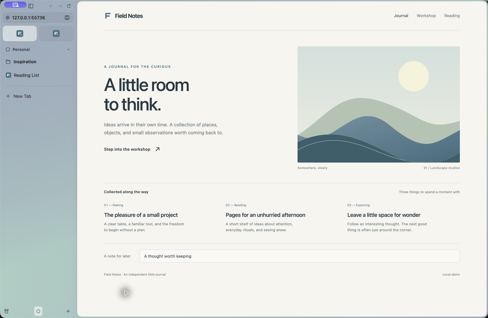
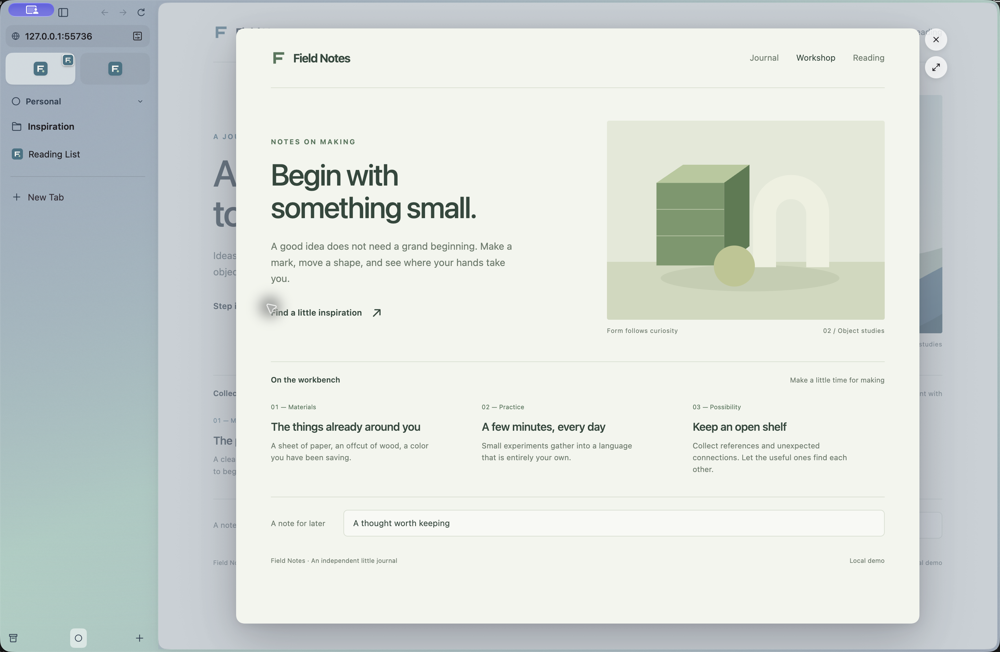
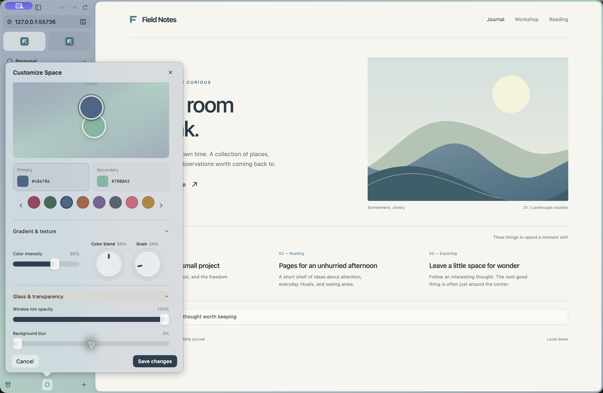

# Zacro Browser

**A familiar home for a more thoughtful way to browse.**

Zacro is an open-source, Arc-inspired browser by Zacro Technologies. Keep your everyday sites close, give each project its own Space, and follow your curiosity without losing your place.

## A place for everything

Keep everyday sites in **Favorites**, pin useful pages to a Space, and organize them in folders. Temporary tabs can clear away with automatic archiving. Closing a Favorite or pin keeps its saved destination ready for next time, with site icons available offline.

Give work, personal projects and new interests their own **Spaces**, each with its own colors, texture and icon. Tactile theme controls let you shape the look as you browse. Separate **profiles** keep accounts and browsing data apart.

## Follow a link without losing your place

**Peek** opens a link over the page you're reading. Shift-click to take a look, press Escape to return, or turn the preview into a full tab when you want to keep it. **Split view** puts two pages side by side; drag the divider to give either page more room. Your splits and Peeks stay with their tabs until you close or separate them.

| Peek | Make each Space yours |
| --- | --- |
|  |  |

Screenshots show the native macOS 0.11.0 build with local demo pages. See the [capture notes](docs/screenshots/README.md).

## Move at the speed of a thought

Press **⌘T** to find a tab, open a site or search the web. The command bar also finds bookmarks, history, Spaces and browser actions. Google is the default search engine; you can choose another in Settings.

Press **⌘S** for a content-only view, **⌘L** to edit the address, or **⌘← / ⌘→** to go back and forward. Bookmarks, history and downloads are within reach in Library. Shortcuts are yours to customize.

## Bring your tools along

Install Chrome extensions and pin your most-used tools beneath the address bar. Site controls bring extensions and page actions together. See the [native extension support and limits](docs/native-parity/engine-extensions.md).

Optional **Ask Zacro** helps you ask questions, summarize pages and compare ideas. Choose a connection and review the page or PDF text you want to share. Supported connections can research the web and link to their sources. [AI connections](docs/AI.md) · [Optional sync](docs/SYNC.md).

## Try Zacro

The **native macOS 0.11.0 implementation** is on the `swift-rewrite` branch. See the [Mac build guide](macos/README.md) and [verification record](docs/native-parity/verification.md). The local build is development-signed; public distribution signing and notarization remain separate release steps.

The earlier Electron desktop preview remains documented in the [0.10 release notes](docs/RELEASE-NOTES-0.10.md). [Website sign-in notes](docs/WEB-SIGN-IN.md) · [Security](docs/SECURITY.md).

## Help shape it

Share a browsing workflow you'd love to improve, report a bug, or contribute a change. Start with the [native implementation guide](macos/README.md) or the [Electron implementation guide](docs/IMPLEMENTATION-CONTRACT.md).

Zacro is an independent project, unaffiliated with The Browser Company. Original code is licensed under [MIT](LICENSE); third-party components retain their own licenses.
