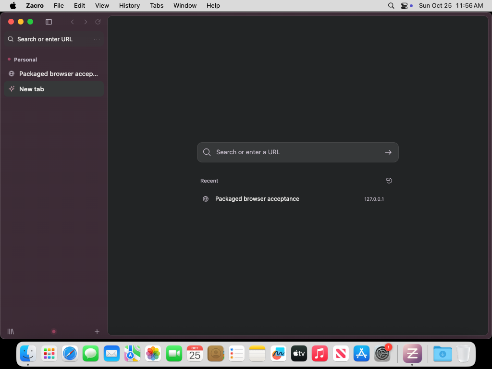

# Zacro on macOS

The Mac implementation targets **macOS 13 or later**, on **Apple silicon (`arm64`) and Intel (`x64`)**. It includes native window chrome and menus, Mac keyboard conventions, Dock reopening, safe web-link delivery, and architecture-matched application packaging. The current 0.5 revision passed [native CI on macOS 15.7.9](https://github.com/Zacro-Technologies/zacro_browser/actions/runs/40190619770) for both architectures: 154 unit/security checks, 39 desktop checks, packaged-application acceptance and development DMG/ZIP generation on each. macOS 13 is the declared minimum, not a completed physical-device test result; physical Mac review and signed/notarized release acceptance remain open.

## Everyday use



This unedited native desktop capture shows the 0.5 Apple silicon development package on macOS 15.7.9, using a disposable profile in [CI run 40190619770](https://github.com/Zacro-Technologies/zacro_browser/actions/runs/40190619770). The optional New Tab Page was opened explicitly during acceptance; an empty Space normally opens the command palette. The [README](../README.md#screenshots) also shows light appearance.

The red, yellow and green window controls are native macOS controls. Their reserved area remains clear when the sidebar is hidden. Full screen uses the operating system's transition and screen arrangement; returning to a window restores the controls' layout. The interface follows system light/dark appearance, reduced motion, reduced transparency and increased contrast, uses the system font, and dims chrome when inactive.

Zacro's menu bar exposes browser actions without adding another menu row inside the window. The application menu contains Settings, Services, Hide and Quit. Window actions use native Minimize, Zoom and Bring All to Front. Edit actions target the focused page or browser field, including Undo, Redo, Select All, and Paste and Match Style. Downloads offer **Show in Finder**. These choices follow [Apple's Mac design guidance](https://developer.apple.com/design/human-interface-guidelines/designing-for-macos) and [Electron's native menu behavior](https://www.electronjs.org/docs/latest/api/menu-item).

Page context menus include spelling suggestions and macOS Look Up for selected text. Native pages use macOS scroll bounce. The Dock menu offers the browser window, command palette and a new private Space without requiring an existing window.

| Action                               | Mac shortcut |
| ------------------------------------ | ------------ |
| Command palette / edit current address | ⌘T or ⌘K / ⌘L |
| Reopen closed tab | ⇧⌘T |
| Close tab / close window | ⌘W / ⇧⌘W |
| Open or bring forward browser window | ⌘N |
| New private Space | ⇧⌘N |
| Recent tabs / reverse recent tabs | ⌃Tab / ⌃⇧Tab |
| Previous / next tab in sidebar order | ⌥⌘↑ / ⌥⌘↓ |
| Previous / next Space | ⌥⌘← / ⌥⌘→ |
| Space by position | ⌃1–9 |
| Tab by position / last tab | ⌘1–8 / ⌘9 |
| Pin or unpin / bookmark | ⌘D / ⌥⌘D |
| Split view | ⌃⇧= |
| Back / forward | ⌘[ / ⌘] |
| Settings / History / Downloads | ⌘, / ⌘Y / ⌘J |
| Toggle sidebar / full screen | ⌘S / ⌃⌘F |
| Save page / keyboard shortcuts | ⇧⌘S / ⌥⌘K |
| Find / print / reload | ⌘F / ⌘P / ⌘R |
| Reload without cache | ⇧⌘R |
| Quit | ⌘Q |

⌘T opens the command palette without creating a tab. An empty Space opens it automatically; submitting an address or search creates the page, and cancelling keeps the Space empty. Choose New Tab Page explicitly to open the home page. The sidebar stays interactive beside the palette. ⌘L edits the current destination, while `/` in the palette searches browser actions.

⌃Tab returns to the most recent tab in the current profile. Keep Control held and press Tab again to move farther back; Shift reverses the direction. The Option-Command-Up/Down commands follow sidebar order instead: pins, folders, then ordinary tabs. Open Keyboard Shortcuts to search, record, disable and reset bindings. Defaults and aliases come from the shared catalog, and overrides are stored separately for macOS. These conventions follow Arc's [command and recent-tab workflow](https://start.arc.net/master-multitasking), [pinning](https://resources.arc.net/hc/en-us/articles/19231060187159-Pinned-Tabs-Tabs-you-want-to-stick-around), and [Space navigation](https://resources.arc.net/hc/en-us/articles/19228064149143-Spaces-Distinct-Browsing-Areas).

⌘Tab remains the system application switcher, and ⌘H hides the application. Horizontal scrolling over the sidebar switches Spaces within the current profile; ordinary webpage scrolling remains with the page. Finger movement previews the neighbor, a short flick or deliberate drag commits one switch, and the momentum tail cannot advance repeatedly. Reversing before commitment cancels the preview; the endpoints resist without wrapping. Each Space retains its tab-list position. Forms, text fields, dragging and pinch/zoom keep their input. Reduced-motion users get the same state changes without the decorative transition. Real trackpad acceptance remains part of the physical-Mac checklist below.

Zacro currently uses one browser window. ⌘N opens that window if closed or brings it forward; it does not create an independent second browsing window. Closing the window keeps the application available in the Dock. Reopening restores tabs and the active Space from the session; pages reload after an approved window close. Beforeunload decisions still protect pages that report unsaved work. Quit exits the application, and cancelling a close warning cancels the pending quit.

Successfully closing the last window ends private sessions: private profile metadata, cookies and session data are cleared before reopening. Cancelling the close keeps the private session intact. Regular profile sessions remain available, and user-saved downloads remain on disk.

The application bundle declares HTTP/HTTPS handling so macOS can offer Zacro for web links. Links received before startup or while no window is open are validated and opened after the window is ready. An installed build exposes an explicit **Default browser** action in Settings that requests the operating system's choice; Zacro does not take over automatically. Local-file browsing and arbitrary protocol handlers remain unsupported.

## Develop and package

Use native Node.js 24 or later on the Mac where the build will run. Install dependencies separately for each architecture:

```sh
npm ci
npm start
npm test
npm run test:mac
npm run pack:mac
npm run test:package
npm run dist:mac
```

The runnable bundle is `dist/mac-arm64/Zacro.app` on Apple silicon and `dist/mac/Zacro.app` on Intel. Development archives are named `Zacro-<version>-mac-<arch>-development.dmg` and `.zip`. The DMG includes an Applications shortcut. The icon contains native `.icns` sizes for Finder and Dock rendering.

Both Electron and Codex are native executables. The build validates their binary architecture and rejects cross-platform, cross-architecture and universal targets rather than shipping a mismatched runtime. Build the two distributions on corresponding hosts; a universal bundle would require a separate native-dependency merge strategy. Browsing remains available without AI authentication. Optional Codex sign-in uses Zacro's isolated OS keyring credentials and never imports a developer's Codex credentials.

Development bundles are ad-hoc signed and omit Hardened Runtime. They are for local validation, not a trusted public release. Publisher release commands require a Developer ID identity and notarization configuration. No Apple credentials are included in this repository or requested by ordinary browsing/build-preview workflows.

## Sign and verify a release

`npm run dist:release` on a native Mac runs source checks, unit tests, the Mac suite, release packaging and packaged acceptance. Configure the signing identity using `CSC_LINK` with `CSC_KEY_PASSWORD`, or an installed Developer ID selected through `CSC_NAME`. Supply one complete notarization mechanism: Apple ID/app-specific password/team ID; App Store Connect API key/key ID/issuer; or an existing `APPLE_KEYCHAIN_PROFILE`. See the release script for exact environment names. Store these through the release operator's secret-management system, not source files.

The release build uses Hardened Runtime and narrowly scoped entitlements, signs the embedded Codex executable, notarizes the application and DMG, and validates signatures and stapled tickets. `codesign`, `spctl`, and `stapler` checks must succeed. The ZIP contains the notarized application. The pipeline does not publish artifacts or configure automatic updates by itself.

Passing a build is only one release gate. A Mac release still needs clean-machine installation and removal, publisher and ticket verification, real site/media/OAuth acceptance, assistive-technology review, and the broader [commercial release requirements](ROADMAP.md).

## Native verification

The GitHub Actions workflow has separate `macos-15` Apple silicon and `macos-15-intel` jobs. Both passed the 0.4 revision on macOS **15.7.9 (24G830)** in [run 40099796398](https://github.com/Zacro-Technologies/zacro_browser/actions/runs/40099796398) at commit `f3101841f04cda2e9441734c0b711f6e63c697e2`: **99 unit/security tests, 32 desktop integration tests and one packaged-application test per architecture**, plus source formatting/syntax and native DMG/ZIP builds. The development artifacts are retained for seven days with explicit architecture labels; they are CI outputs, not a public signed/notarized release.

Those results and the screenshots refer to that exact commit. They do not yet establish native Mac acceptance of the command, shortcut and trackpad changes described above; record the new run separately when it completes.

The Darwin-only suite covers native traffic-light position and layout, menu conventions, Cmd-based shortcuts, Ctrl-Tab, native full screen, guest-page editing, window close/Dock reopen, validated web links, pre-ready link delivery, cancellation of Quit with unsaved work, and private-session cleanup after the last window closes. It is skipped on non-Mac hosts. The Mac command also runs shared browser, renderer contract, motion, Space-scroll, security and startup native-paint tests. The packaged suite checks actual browsing, security fuses, PDF parsing and an isolated signed-out Codex handshake; it does not make authenticated model requests.

Before release, test on physical Apple silicon and Intel Macs with a keyboard and trackpad, multiple displays, full screen, Spaces/Mission Control, Finder file dialogs, camera/microphone/location consent, printing, VoiceOver, keyboard-only navigation, reduced motion and display scaling. Complete ChatGPT authentication yourself to validate subscription behavior; tests never automate a personal login. Record OS versions, architecture, exact commit and observed limitations in [the validation record](VALIDATION.md).

References: [Apple Mac design guidance](https://developer.apple.com/design/human-interface-guidelines/designing-for-macos), [Electron window controls](https://www.electronjs.org/docs/latest/api/browser-window), [Electron app lifecycle](https://www.electronjs.org/docs/latest/api/app), [Electron's macOS minimum version](https://www.electronjs.org/blog/electron-44-0), [GitHub's native Mac runners](https://docs.github.com/en/actions/reference/runners/github-hosted-runners), and [Electron macOS signing guidance](https://www.electronjs.org/docs/latest/tutorial/code-signing#macos).
